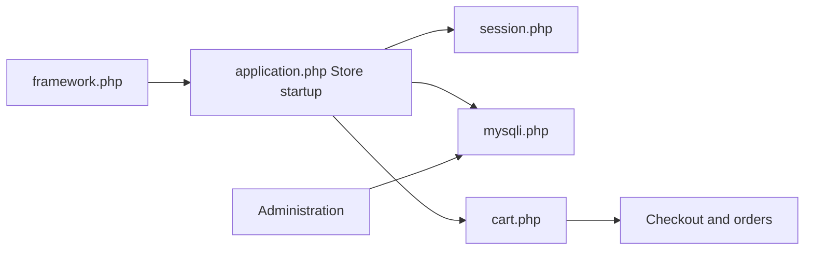

# opencart/opencart

> Plateforme e-commerce libre en PHP, pour commerçants et développeurs de boutiques.

## Le problème
Ouvrir une boutique en ligne sans développer catalogue, panier et commandes.

## Ce que ça fait vraiment
Boutique en PHP avec vitrine, panier, tunnel de commande, administration du catalogue, avis, gestionnaire d'images, localisation, extensions et tâches planifiées. Le dépôt fournit un environnement Docker de développement (Apache, PHP 8.4 par défaut, MariaDB) avec Adminer, Redis, Memcached ou PostgreSQL en option.

## Comment c'est branché


## Essayer
```bash
make init
make build
make up
make down
```
La boutique est alors disponible sur `http://localhost`.

## Coût et pièges
Gratuit. Sous Windows, WSL 2 est fortement conseillé, sinon les performances sont très faibles. Licence présente mais non identifiée par GitHub.

## Ce que ce n'est pas
Pas une solution clé en main de support : les bogues d'extensions tierces sont fermés sans suite, selon le README.

## Alternatives
- Aucune alternative nommée dans le README.

## Pour toi
À ignorer : e-commerce PHP, sans rapport avec la data/IA ; licence à vérifier.

