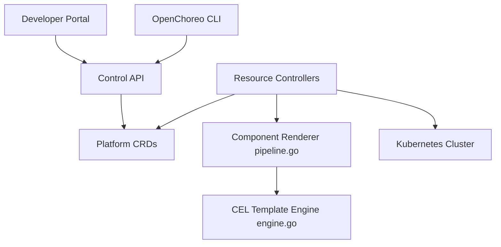

# openchoreo/openchoreo

> An open source developer platform for Kubernetes, a CNCF Sandbox project originating from WSO2, for platform teams.

## The problem
Kubernetes is too low-level for developers. Platform teams assemble a portal, CI, GitOps, observability and permissions, then maintain the glue.

## What it actually does
Provides abstractions (components, endpoints, dependencies, environments, pipelines) expressed as Kubernetes CRDs. A control plane authorizes and persists them, and controllers render them into manifests via a CEL engine. Planes: experience (Backstage portal, CLI, AI agents), control, data, observability, plus an optional CI plane (Buildpacks, Argo Workflows). ComponentTypes, Traits and Workflows define the paved paths.

## How it is wired

## Trying it
The provided README contains no command: it points to the Quick Start Guide (Dev Container) and the Installation Guide, not reproduced here.

## Cost and gotchas
Free, but requires a Kubernetes cluster to operate. 294 open issues. The portal, CI and GitOps links are described by the documentation, not confirmed by the sampled code.

## What it is not
Not a simple deployment tool. Not a fork of WSO2 Choreo: it is a rewrite, according to the README.

## Alternatives
None named in the README (Backstage and Argo Workflows are building blocks).

## For you
Worth watching: useful if your MLOps platform is built on Kubernetes and you want a common base, heavy for isolated use.
