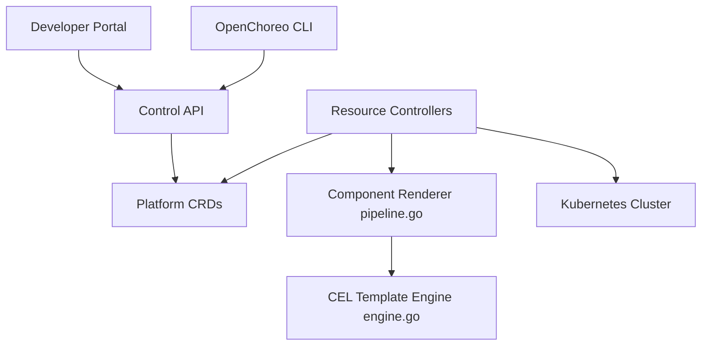

# openchoreo/openchoreo

> Plateforme développeur open source pour Kubernetes, projet CNCF Sandbox issu de WSO2, pour équipes plateforme.

## Le problème
Kubernetes est trop bas niveau pour les développeurs. Les équipes plateforme assemblent portail, CI, GitOps, observabilité et droits, puis maintiennent la colle.

## Ce que ça fait vraiment
Fournit des abstractions (composants, endpoints, dépendances, environnements, pipelines) exprimées en CRDs Kubernetes. Un plan de contrôle les autorise, les persiste et des contrôleurs les rendent en manifestes via un moteur CEL. Plans : expérience (portail Backstage, CLI, agents IA), contrôle, données, observabilité, plus un plan CI optionnel (Buildpacks, Argo Workflows). ComponentTypes, Traits et Workflows définissent les chemins balisés.

## Comment c'est branché

## Essayer
Le README fourni ne contient aucune commande : il renvoie au Quick Start Guide (Dev Container) et à l'Installation Guide, non reproduits ici.

## Coût et pièges
Gratuit, mais exige un cluster Kubernetes à exploiter. 294 issues ouvertes. Les liens portail, CI et GitOps sont décrits par la documentation, pas confirmés par le code échantillonné.

## Ce que ce n'est pas
Pas un simple outil de déploiement. Pas un fork de WSO2 Choreo : c'est une réécriture, selon le README.

## Alternatives
Aucune nommée dans le README (Backstage et Argo Workflows sont des briques).

## Pour toi
À surveiller : utile si ta plateforme MLOps se bâtit sur Kubernetes et que tu veux une base commune, lourde pour un usage isolé.

