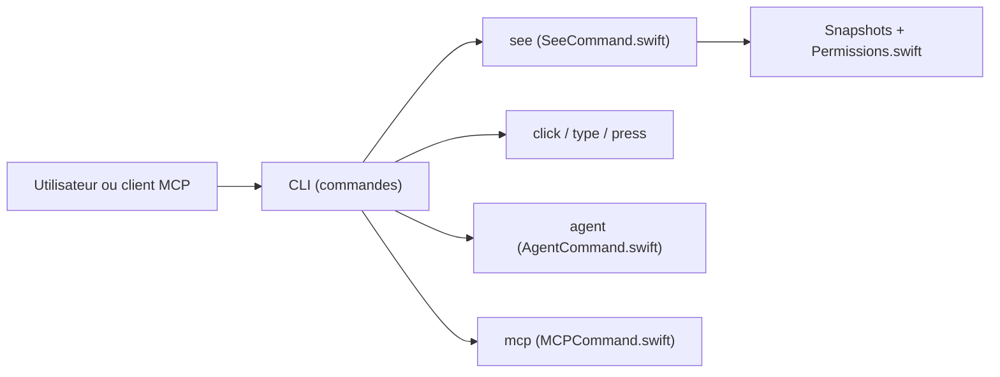

# openclaw/Peekaboo

> CLI and macOS app to capture the screen, inspect the interface and automate clicks, usable by MCP agents.

## The problem
Agents and scripts cannot see the screen nor drive native macOS applications in a structured way.

## What it actually does
`peekaboo see` captures the screen or an app and returns a map of the interface with element identifiers; `click`, `type`, `press`, `scroll`, `menu`, `window` act on it, in the background if the window is resolved. An agent runs tasks in natural language (`peekaboo agent`) and the same toolset is exposed as an MCP server (Codex, Claude Code, Cursor). A menu bar app manages permissions and sessions.

## How it is wired


## Trying it
```bash
brew install openclaw/tap/peekaboo
peekaboo permissions status
peekaboo see --app Finder --json
npx -y @steipete/peekaboo --version
```

## Cost and gotchas
macOS 15+; Screen Recording and Accessibility permissions required. Agent mode requires a configured model provider (keys in `~/.peekaboo`). Node 22+ for npm.

## What it is not
Not cross-platform: macOS only. The agent can act on your machine; foreground consents are explicit but worth watching.

## Alternatives
Not documented in the README: no alternative named.

## For you
Worth watching if you work on a Mac with coding agents: a tool for observing and acting on the screen extends what an MCP client can do; useless otherwise on Linux.
