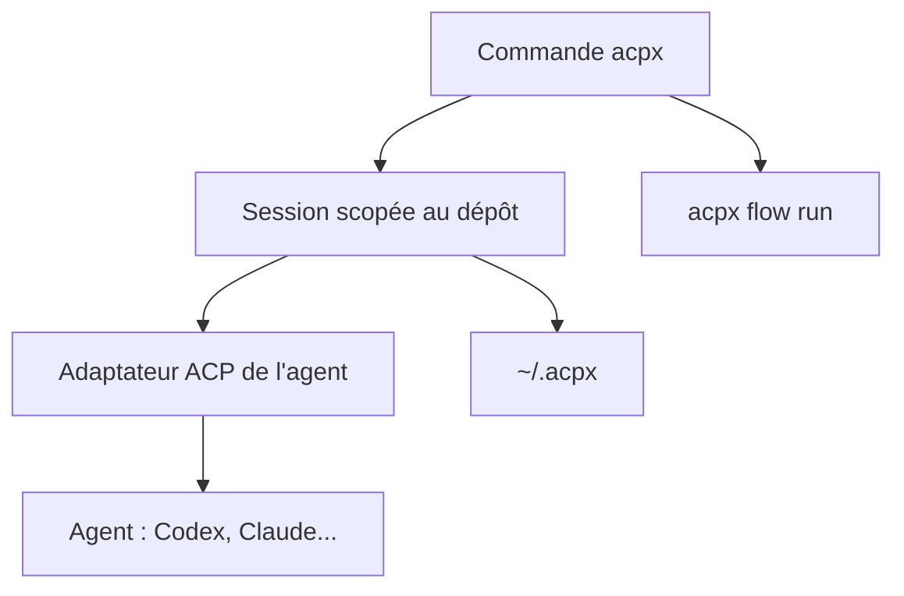

# openclaw/acpx

> Command-line client for driving ACP-compatible coding agents in a uniform way.

## The problem
Each coding agent has its own interface; automating several agents requires one adapter per agent.

## What it actually does
`acpx` offers a single syntax for 30 agent profiles (Codex, Claude Code, Gemini CLI, Cursor, Copilot, OpenCode, Pi...). It handles persistent sessions, one-off runs (`exec`), permissions and NDJSON output. `acpx flow run` runs TypeScript workflows, and `acpx/runtime` can be embedded in an application.

## How it is wired
Simplified diagram based on the fiche, no diagram provided.



## Trying it
```bash
npm install -g acpx@latest
acpx codex sessions new
acpx codex "find the slowest test and explain why"
acpx codex exec "summarize this repository"
```

## Cost and gotchas
Node 22.13 minimum. You must install and authenticate the target agent: usage is billed by its provider. Pre-1.0, the CLI may change.

## What it is not
Not an agent: a client that talks to agents. It does not provide the models or the accounts.

## Alternatives
No alternative named in the README.

## For you
Adopt: handy for scripting or comparing several agents from a shell or CI, with machine-readable output.
