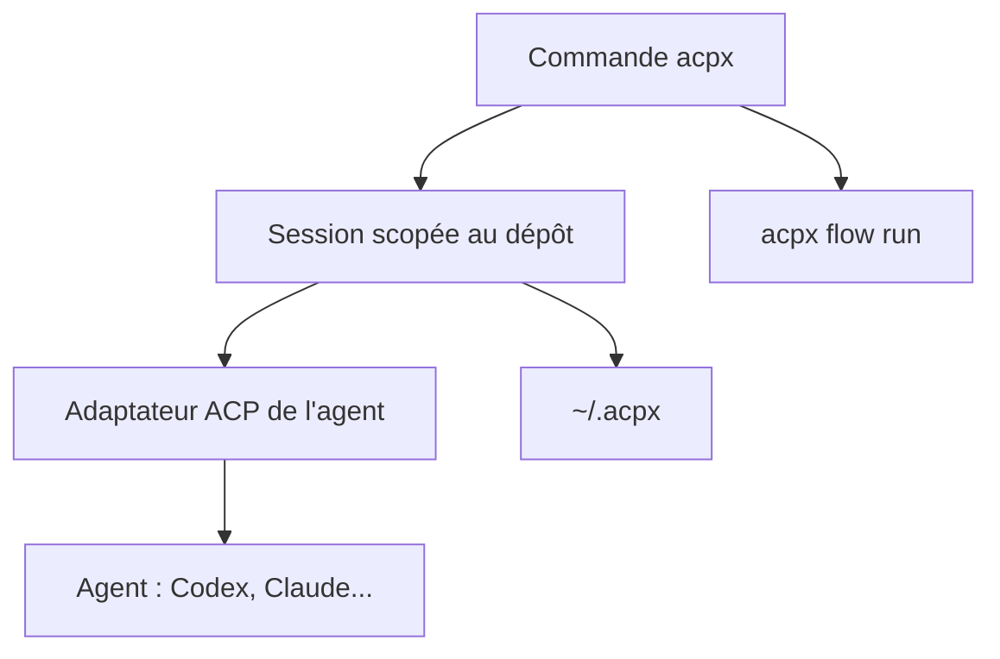

# openclaw/acpx

> Client en ligne de commande pour piloter, de façon uniforme, des agents de code compatibles ACP.

## Le problème
Chaque agent de code a sa propre interface ; automatiser plusieurs agents demande un adaptateur par agent.

## Ce que ça fait vraiment
`acpx` offre une seule syntaxe pour 30 profils d'agents (Codex, Claude Code, Gemini CLI, Cursor, Copilot, OpenCode, Pi...). Il gère sessions persistantes, exécutions ponctuelles (`exec`), permissions et sortie NDJSON. `acpx flow run` exécute des workflows TypeScript, et `acpx/runtime` s'embarque dans une application.

## Comment c'est branché
Schéma simplifié d'après la fiche, sans diagramme fourni.



## Essayer
```bash
npm install -g acpx@latest
acpx codex sessions new
acpx codex "find the slowest test and explain why"
acpx codex exec "summarize this repository"
```

## Coût et pièges
Node 22.13 minimum. Il faut installer et authentifier l'agent visé : l'usage est facturé par son fournisseur. Pré-1.0, la CLI peut changer.

## Ce que ce n'est pas
Pas un agent : un client qui parle à des agents. Il ne fournit pas les modèles ni les comptes.

## Alternatives
Aucune alternative nommée dans le README.

## Pour toi
À adopter : pratique pour scripter ou comparer plusieurs agents depuis un shell ou une CI, avec une sortie lisible par machine.

