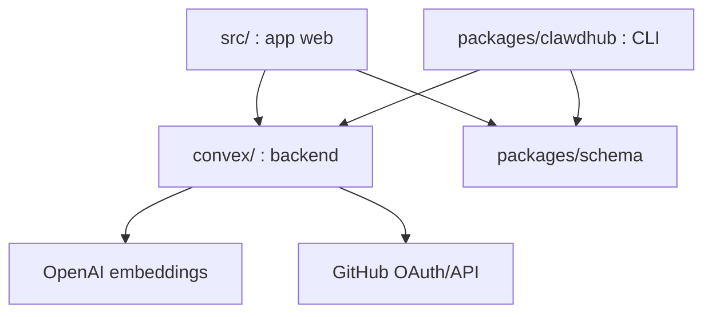

# openclaw/clawhub

> Public registry of OpenClaw agent skills: publish, version and search SKILL.md files.

## The problem
Agent skills circulate as scattered files, with no versions, no search and no moderation.

## What it actually does
Web application (TanStack Start) backed by Convex (database, storage, GitHub OAuth auth). It publishes versioned skills with tags and changelogs, manages "souls", and a catalog of OpenClaw plugins. Search uses OpenAI embeddings (`text-embedding-3-small`). A `clawhub` CLI handles installs, sync and publishing.

## How it is wired


## Trying it
```bash
bun install
cp .env.local.example .env.local
bunx convex dev
bun run dev
bun run seed:dev
```

## Cost and gotchas
Self-hosting requires Convex, a GitHub OAuth app, JWT keys and `OPENAI_API_KEY`. Install telemetry during `clawhub sync`: can be disabled with `CLAWHUB_DISABLE_TELEMETRY=1`.

## What it is not
Not an agent framework: it is a registry. It does not guarantee the safety of a skill, even with its security analyses.

## Alternatives
No alternative named in the README.

## For you
Keep an eye on it: only useful if you adopt the OpenClaw ecosystem and want to publish or fetch skills.
