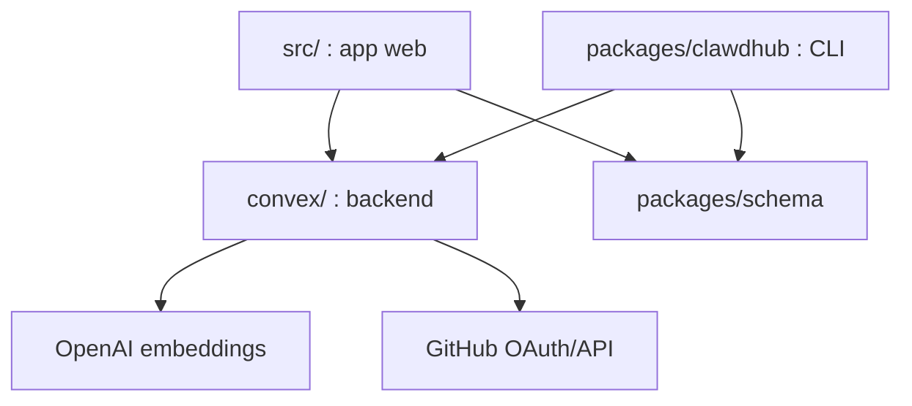

# openclaw/clawhub

> Registre public de skills d'agents OpenClaw : publier, versionner et chercher des SKILL.md.

## Le problème
Les skills d'agents circulent en fichiers épars, sans versions, sans recherche ni modération.

## Ce que ça fait vraiment
Application web (TanStack Start) adossée à Convex (base, stockage, auth GitHub OAuth). Elle publie des skills versionnés avec tags et changelogs, gère les « souls », et un catalogue de plugins OpenClaw. La recherche passe par des embeddings OpenAI (`text-embedding-3-small`). Une CLI `clawhub` gère installs, sync et publication.

## Comment c'est branché


## Essayer
```bash
bun install
cp .env.local.example .env.local
bunx convex dev
bun run dev
bun run seed:dev
```

## Coût et pièges
Auto-héberger demande Convex, une app GitHub OAuth, des clés JWT et `OPENAI_API_KEY`. Télémétrie d'installation lors de `clawhub sync` : désactivable par `CLAWHUB_DISABLE_TELEMETRY=1`.

## Ce que ce n'est pas
Pas un framework d'agents : c'est un registre. Il ne garantit pas la sûreté d'un skill, même avec ses analyses de sécurité.

## Alternatives
Aucune alternative nommée dans le README.

## Pour toi
Surveiller : utile seulement si tu adoptes l'écosystème OpenClaw et veux publier ou récupérer des skills.

