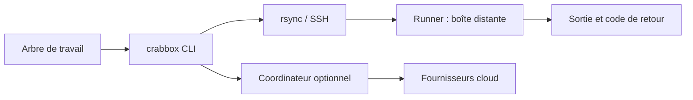

# openclaw/crabbox

> CLI that runs your repository's commands on a remote machine or a container, with code synchronization.

## The problem
Testing code being edited requires pushing a commit or reproducing the environment by hand on a remote machine.

## What it actually does
`crabbox run` synchronizes the working tree (including uncommitted files), runs the command, and returns the output and exit code. Providers: local Docker/Podman container, SSH hosts, AWS, Azure, Google Cloud, Hetzner, Proxmox, Incus, Firecracker, Apple VM, Daytona, E2B, Modal, RunPod. Reusable boxes (`warmup`), named tasks in `.crabbox.yaml`, report collection. An optional coordinator manages credentials, leases and spending caps.

## How it is wired


## Trying it
```bash
brew install openclaw/tap/crabbox
crabbox doctor --provider local-container
crabbox run --provider local-container -- uname -a
crabbox warmup --provider local-container --slug dev-box
crabbox run --provider local-container --id dev-box -- uname -a
crabbox stop --provider local-container dev-box
```

## Cost and gotchas
Local: free. Cloud providers bill you. The default box is empty: install Node, Go, etc. yourself. Outputs and failure bundles are not scrubbed of secrets.

## What it is not
Not a hostile multi-tenant sandbox, nor a secret scrubber, nor a CI replacement. The mounted container socket gives access to the host engine.

## Alternatives
No alternative named in the README.

## For you
Adopt: useful for running heavy test suites or GPU jobs (RunPod) from your machine, trying the free local container mode first.
