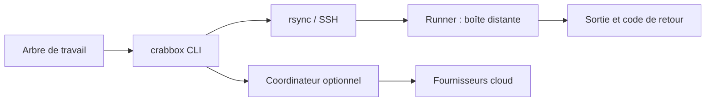

# openclaw/crabbox

> CLI qui exécute les commandes de ton dépôt sur une machine distante ou un conteneur, avec synchronisation du code.

## Le problème
Tester du code en cours d'édition demande de pousser un commit ou de reproduire l'environnement à la main sur une machine distante.

## Ce que ça fait vraiment
`crabbox run` synchronise l'arbre de travail (y compris les fichiers non commités), exécute la commande, renvoie la sortie et le code de sortie. Fournisseurs : conteneur local Docker/Podman, hôtes SSH, AWS, Azure, Google Cloud, Hetzner, Proxmox, Incus, Firecracker, Apple VM, Daytona, E2B, Modal, RunPod. Boîtes réutilisables (`warmup`), tâches nommées dans `.crabbox.yaml`, collecte de rapports. Un coordinateur optionnel gère identifiants, baux et plafonds de dépense.

## Comment c'est branché


## Essayer
```bash
brew install openclaw/tap/crabbox
crabbox doctor --provider local-container
crabbox run --provider local-container -- uname -a
crabbox warmup --provider local-container --slug dev-box
crabbox run --provider local-container --id dev-box -- uname -a
crabbox stop --provider local-container dev-box
```

## Coût et pièges
Local : gratuit. Les fournisseurs cloud facturent à ta charge. La boîte par défaut est vide : installe Node, Go, etc. toi-même. Sorties et bundles d'échec ne sont pas nettoyés des secrets.

## Ce que ce n'est pas
Pas un bac à sable multi-locataire hostile, ni un nettoyeur de secrets, ni un remplaçant de la CI. Le socket de conteneur monté donne accès au moteur hôte.

## Alternatives
Aucune alternative nommée dans le README.

## Pour toi
À adopter : utile pour lancer des suites de tests lourdes ou des jobs sur GPU (RunPod) depuis ton poste, en essayant d'abord le mode conteneur local gratuit.

