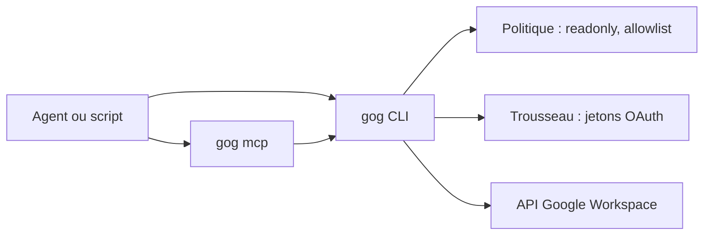

# openclaw/gogcli

> Command-line client for Gmail, Calendar, Drive and the rest of Google Workspace, for scripts and agents.

## The problem
Driving Google Workspace from a script or an agent requires handling OAuth, several accounts and permission limits, with no safeguards against write actions.

## What it actually does
A `gog` binary covers Gmail, Calendar, Drive, Docs, Sheets, Slides, Forms, contacts, tasks, Meet, Chat, Analytics, administration. Output is `--json` or stable TSV. Safety options: `--readonly`, exact command allowlist, `--gmail-no-send`, `--wrap-untrusted`, dry runs. `gog mcp` exposes a stdio MCP server, read-only by default. The command schema is generated by the binary.

## How it is wired


## Trying it
```bash
brew install openclaw/tap/gogcli
gog auth credentials set ~/Downloads/client_secret_*.json
gog auth add you@gmail.com --services gmail,calendar,drive
gog auth doctor --check
gog --readonly gmail search 'is:unread newer_than:7d' --max 10 --json
```

## Cost and gotchas
Free, but you must create a "Desktop" OAuth client in a Google Cloud project. The admin, Chat and Keep APIs require a managed Workspace domain.

## What it is not
Not affiliated with Google. A consumer account does not cover administration or groups.

## Alternatives
No alternative named in the README (it cites gmcli, gccli and gdcli as inspirations).

## For you
Adopt: to give an agent Workspace access bounded by allowlists and read-only mode, it is a solid base; always start with `--readonly`.
