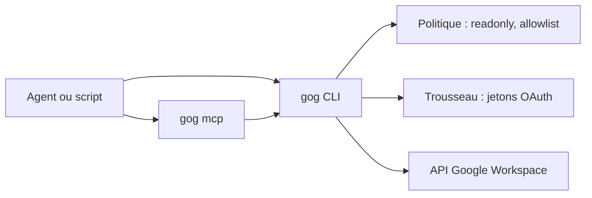

# openclaw/gogcli

> Client en ligne de commande pour Gmail, Agenda, Drive et le reste de Google Workspace, pour scripts et agents.

## Le problème
Piloter Google Workspace depuis un script ou un agent exige de gérer OAuth, plusieurs comptes et des limites de droits, sans garde-fous contre les actions d'écriture.

## Ce que ça fait vraiment
Un binaire `gog` couvre Gmail, Calendar, Drive, Docs, Sheets, Slides, Forms, contacts, tâches, Meet, Chat, Analytics, administration. Sorties `--json` ou TSV stable. Options de sécurité : `--readonly`, liste blanche exacte de commandes, `--gmail-no-send`, `--wrap-untrusted`, plans à blanc. `gog mcp` expose un serveur MCP stdio, en lecture seule par défaut. Le schéma des commandes est généré par le binaire.

## Comment c'est branché


## Essayer
```bash
brew install openclaw/tap/gogcli
gog auth credentials set ~/Downloads/client_secret_*.json
gog auth add you@gmail.com --services gmail,calendar,drive
gog auth doctor --check
gog --readonly gmail search 'is:unread newer_than:7d' --max 10 --json
```

## Coût et pièges
Gratuit, mais il faut créer un client OAuth « Desktop » dans un projet Google Cloud. Les API d'administration, Chat et Keep exigent un domaine Workspace géré.

## Ce que ce n'est pas
Pas affilié à Google. Un compte grand public ne couvre pas l'administration ni les groupes.

## Alternatives
Aucune alternative nommée dans le README (il cite gmcli, gccli et gdcli comme inspirations).

## Pour toi
À adopter : pour donner à un agent un accès Workspace borné par des listes blanches et une lecture seule, c'est une base sérieuse ; commence toujours avec `--readonly`.

