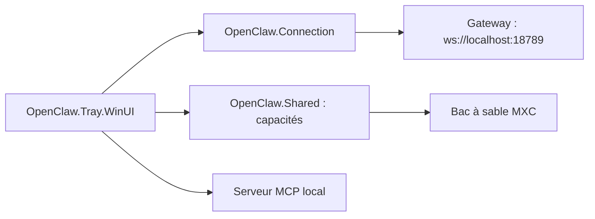

# openclaw/openclaw-windows-node

> Native Windows application that connects a PC to an OpenClaw Gateway and chooses what agents can do.

## The problem
An OpenClaw agent does not see your Windows PC: no shell, screen, camera or browser, unless you expose them by hand and without safeguards.

## What it actually does
A system tray application (WinUI 3) with a setup wizard to install a local Gateway in WSL or connect to an existing Gateway. "Node mode" advertises capabilities to enable one by one: system commands, browser, camera, canvas, screen capture, location, speech synthesis and recognition. Three sandbox presets (Strict, Balanced, Open) via the Microsoft.Mxc SDK. Native chat, local MCP server, `openclaw://` links.

## How it is wired


## Trying it
```powershell
.\scripts\setup-dev.ps1
.\build.ps1
.\run-app-local.ps1 -Isolated
dotnet test .\tests\OpenClaw.Shared.Tests\OpenClaw.Shared.Tests.csproj
```

## Cost and gotchas
Free; Windows 10 20H2 or newer, or 11. Sensitive capabilities (camera, screen, microphone, `system.run`) should be left disabled unless needed. On an unsupported Windows, direct execution without confinement is possible with a warning.

## What it is not
Not the Gateway itself: it is a companion that depends on the OpenClaw ecosystem. The sandbox only covers commands passed through the Node.

## Alternatives
No alternative named in the README.

## For you
Worth watching: only if you adopt OpenClaw on Windows; the per-capability permission and sandbox model is instructive for giving tools to an agent.
