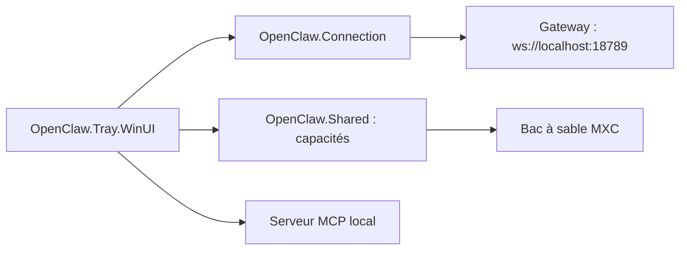

# openclaw/openclaw-windows-node

> Application Windows native qui connecte un PC à un Gateway OpenClaw et choisit ce que les agents peuvent faire.

## Le problème
Un agent OpenClaw ne voit pas ton PC Windows : pas de shell, d'écran, de caméra ni de navigateur, sauf à les exposer à la main et sans garde-fous.

## Ce que ça fait vraiment
Application de barre d'état (WinUI 3) avec assistant d'installation d'un Gateway local dans WSL ou connexion à un Gateway existant. Le « mode Node » annonce des capacités à activer une par une : commandes système, navigateur, caméra, canvas, capture d'écran, localisation, synthèse et reconnaissance vocale. Trois préréglages de bac à sable (Strict, Balanced, Open) via le SDK Microsoft.Mxc. Chat natif, serveur MCP local, liens `openclaw://`.

## Comment c'est branché


## Essayer
```powershell
.\scripts\setup-dev.ps1
.\build.ps1
.\run-app-local.ps1 -Isolated
dotnet test .\tests\OpenClaw.Shared.Tests\OpenClaw.Shared.Tests.csproj
```

## Coût et pièges
Gratuit ; Windows 10 20H2 ou plus, ou 11. Les capacités sensibles (caméra, écran, micro, `system.run`) sont à laisser désactivées sauf besoin. Sur un Windows non pris en charge, l'exécution directe sans confinement est possible avec un avertissement.

## Ce que ce n'est pas
Pas le Gateway lui-même : c'est un compagnon qui dépend de l'écosystème OpenClaw. Le bac à sable ne couvre que les commandes passées par le Node.

## Alternatives
Aucune alternative nommée dans le README.

## Pour toi
À surveiller : seulement si tu adoptes OpenClaw sous Windows ; le modèle de permissions par capacité et de bac à sable est instructif pour donner des outils à un agent.

