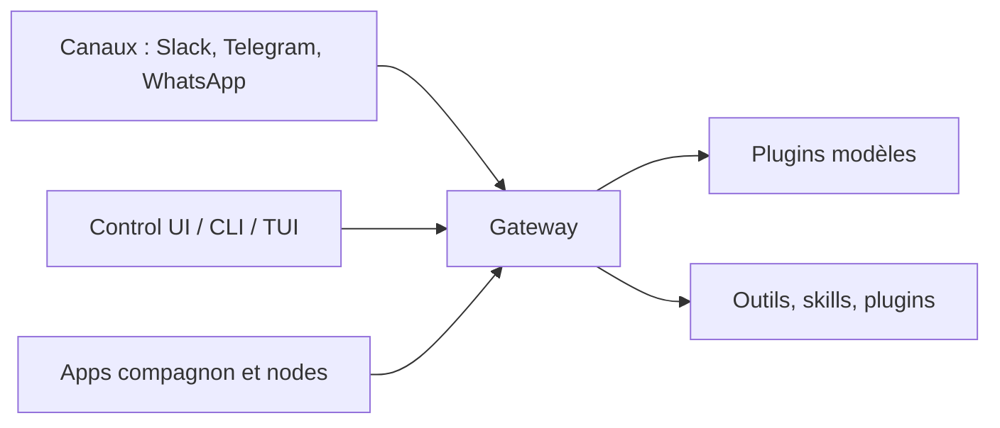

# openclaw/openclaw

> An open-source AI assistant that runs on your machine and responds to messages in your messaging apps (Slack, Telegram, WhatsApp, etc.).

## The problem
AI assistants live within their own applications, hosted by the provider. Connecting them to existing chat channels, while maintaining control over the status and credentials, requires a significant amount of integration work.

## What it actually does
A local gateway acts as a control center: it manages sessions, tools, events, and connections to channels (over 20, including Discord, iMessage, Slack, and Teams). The models (Claude, Codex, and local models) are interchangeable plugins. Companion applications (for macOS, iOS, Android, Windows, and Linux) add voice, Canvas, and camera functionality. Incoming messages are treated as untrusted: unknown senders must be paired.

## How it is wired


## Trying it
```bash
curl -fsSL https://openclaw.ai/install.sh | bash
npm install -g openclaw@latest --allow-scripts=openclaw
openclaw onboard --install-daemon
openclaw gateway status
openclaw dashboard
```

## Cost and gotchas
The software is free, with no paid options; any calls to the model provider that you configure remain your responsibility. Without a configured sandbox, the tools run on the host for the main session: read the security guides before exposing the Gateway.

## What it is not
Not a hosted service: your prompts still go to the chosen model provider and chat platforms. A daily version check is performed by default, and anonymous statistics are opt-in. The repository is developed using pnpm, not npm.

## Alternatives
No alternative is specified in the README file.

## For you
Things to watch out for: A multi-channel, self-hosted personal assistant is useful for experimenting with different agents on a daily basis, but the attack surface (incoming messages + execution of tools on the host) requires significant hardening before any serious use.
