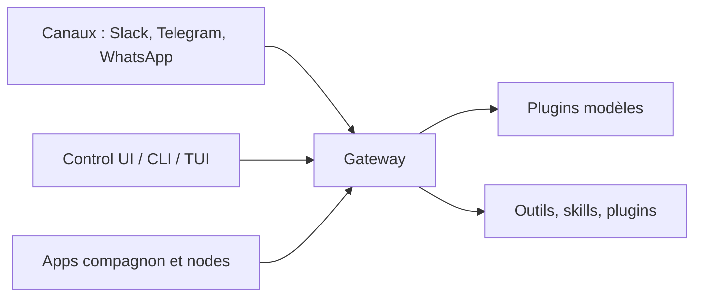

# openclaw/openclaw

> Assistant IA open source qui tourne sur ta machine et répond dans tes messageries (Slack, Telegram, WhatsApp…).

## Le problème
Les assistants IA vivent dans leur propre application, hébergés chez le fournisseur. Les brancher sur les canaux de discussion déjà utilisés, avec état et identifiants gardés chez soi, demande beaucoup de colle.

## Ce que ça fait vraiment
Un Gateway local sert de plan de contrôle : sessions, outils, événements et connexions aux canaux (plus de 20, dont Discord, iMessage, Slack, Teams). Les modèles (Claude, Codex, modèles locaux) sont des plugins interchangeables. Des applications compagnon (macOS, iOS, Android, Windows, Linux) ajoutent voix, Canvas, caméra, écran. Les messages entrants sont traités comme non fiables : les expéditeurs inconnus doivent être appairés.

## Comment c'est branché


## Essayer
```bash
curl -fsSL https://openclaw.ai/install.sh | bash
npm install -g openclaw@latest --allow-scripts=openclaw
openclaw onboard --install-daemon
openclaw gateway status
openclaw dashboard
```

## Coût et pièges
Le logiciel est gratuit, sans offre payante ; les appels au fournisseur de modèle que tu configures restent à ta charge. Sans sandbox configuré, les outils s'exécutent sur l'hôte pour la session principale : lire les guides de sécurité avant d'exposer le Gateway.

## Ce que ce n'est pas
Pas un service hébergé : tes prompts partent quand même vers le fournisseur de modèle et les plateformes de chat choisis. Une vérification de version quotidienne est faite par défaut, les statistiques anonymes sont opt-in. Le dépôt se développe avec pnpm, pas npm.

## Alternatives
Aucune alternative nommée dans le README.

## Pour toi
À surveiller : un agent personnel multi-canaux auto-hébergé est utile pour expérimenter des agents au quotidien, mais la surface d'attaque (messages entrants + exécution d'outils sur l'hôte) demande un vrai durcissement avant tout usage sérieux.

