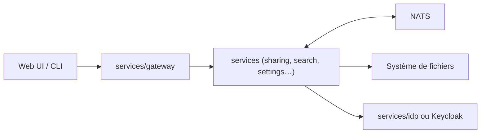

# opencloud-eu/opencloud

> Go backend server of a self-hosted file-sharing platform, for teams and organizations.

## The problem
Hosting your own collaborative storage without depending on an American cloud.

## What it actually does
Monorepo of many Go services (gateway, sharing, search, settings, collaboration, notifications, activity log) supervised by the `opencloud` binary. OpenID Connect authentication through Keycloak or the built-in LibreGraph Connect IdP. No database: everything is stored in the file system (`$HOME/.opencloud`). NATS event bus.

## How it is wired


## Trying it
```bash
make generate
make -C opencloud build
opencloud/bin/opencloud init && opencloud/bin/opencloud server
```

## Cost and gotchas
Free, Apache-2.0. Built from source; most users will go through the installation docs. Many open issues (445), project created in January 2025.

## What it is not
This repository is only the backend; the web client and the guided installation live elsewhere.

## Alternatives
None named in the README.

## For you
Worth watching: interesting for hosting datasets internally, but it is storage, not AI.
