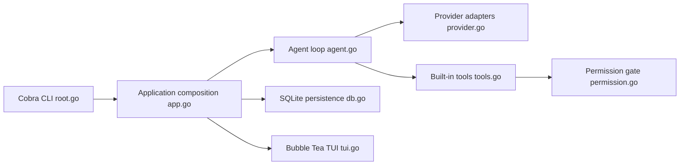

# opencode-ai/opencode

> AI coding assistant in the terminal (Go, TUI), archived in favor of Crush.

## The problem
Coding with an LLM outside an IDE, in a terminal, with file and shell tools and several providers.

## What it actually does
Bubble Tea TUI, sessions stored in SQLite, automatic compaction at 95% of the context.
Tools: glob, grep, view, write, edit, patch, bash, fetch, sourcegraph, sub-agent; permissions to approve.
Providers: OpenAI, Anthropic, Gemini, Bedrock, Groq, Azure, OpenRouter, Copilot, local endpoint.
MCP (stdio, SSE), LSP diagnostics, custom commands in Markdown.

## How it is wired


## Trying it
```bash
brew install opencode-ai/tap/opencode
go install github.com/opencode-ai/opencode@latest
opencode -p "Explain the use of context in Go" -f json
```

## Cost and gotchas
Providers' API keys are on you. In non-interactive mode, all permissions are auto-approved.

## What it is not
Archived: no longer maintained. Do not confuse with active projects with a similar name.

## Alternatives
- charmbracelet/crush: official successor by the original author and the Charm team.

## For you
Ignore: archived, go straight to Crush if the approach interests you.
