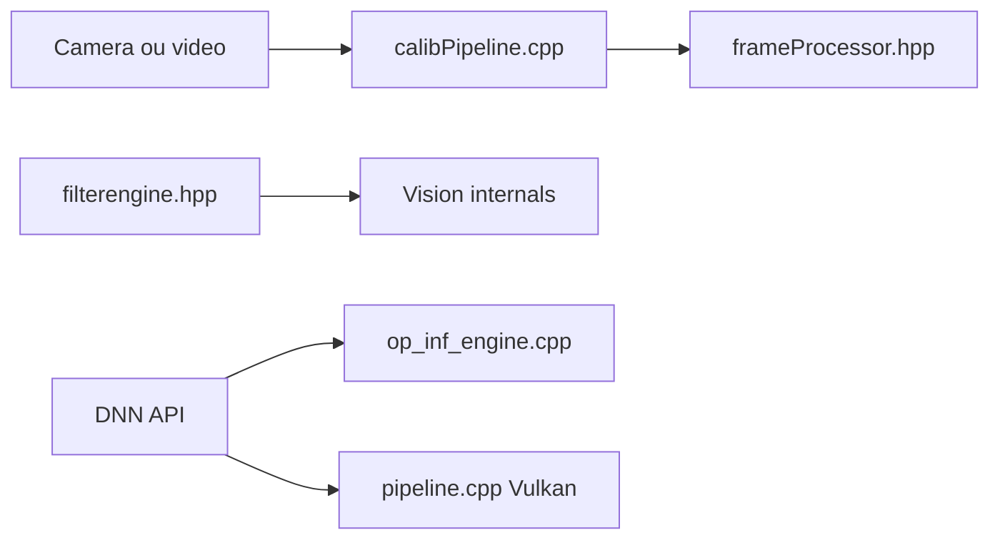

# opencv/opencv

> Open-source computer vision library, for researchers and engineers in the field of image processing.

## The problem
Image and video processing (filters, calibration, detection) requires a robust and portable foundation.

## What it actually does
The README is a list of links (website, course, forum, ticket tracking) without any descriptions of functionalities. Based on the directory structure, we can see a camera calibration application (capture, frame processing, display), a filtering engine, and backends for OpenVINO and Vulkan. The remaining modules are not visible: they are undocumented.

## How it is wired


## Trying it
```bash
# aucune commande dans le README : voir la documentation en ligne
```

## Cost and gotchas
Free, Apache-2.0 license. Optional hardware acceleration (OpenVINO, Vulkan). Poor README: links removed during extraction.

## What it is not
This is not a training model or framework; it is a basic image processing foundation. The documentation is very limited due to the lack of content.

## Alternatives
No alternative is specified in the README.

## For you
Suitable for image preprocessing and light-weight DNN inference within a computer vision pipeline: a standard, well-equipped solution.
