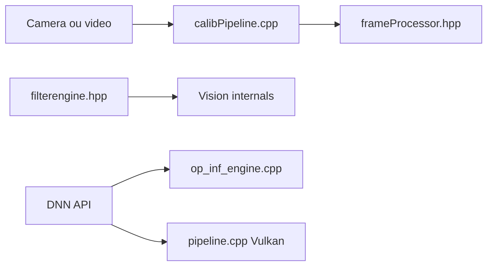

# opencv/opencv

> Bibliothèque de vision par ordinateur open source, pour chercheurs et ingénieurs en image.

## Le problème
Le traitement d'images et de vidéos (filtres, calibration, détection) demande un socle optimisé et portable.

## Ce que ça fait vraiment
Le README est une liste de liens (site, cours, forum, suivi des tickets) sans description de capacités. D'après l'arborescence, on voit une application d'étalonnage de caméra (capture, processeurs de trames, affichage), un moteur de filtrage et des backends DNN pour OpenVINO et Vulkan. Le reste des modules n'est pas visible : non documenté.

## Comment c'est branché


## Essayer
```bash
# aucune commande dans le README : voir la documentation en ligne
```

## Coût et pièges
Gratuit, Apache-2.0. Matériel d'accélération optionnel (OpenVINO, Vulkan). README pauvre : liens retirés à l'extraction.

## Ce que ce n'est pas
Pas un modèle ni un framework d'entraînement : c'est un socle de traitement d'image. La fiche reste étroite faute de contenu.

## Alternatives
Aucune alternative nommée dans le README.

## Pour toi
À adopter pour le prétraitement d'images et les inférences DNN légères dans un pipeline de vision : standard de fait, bien outillé.

