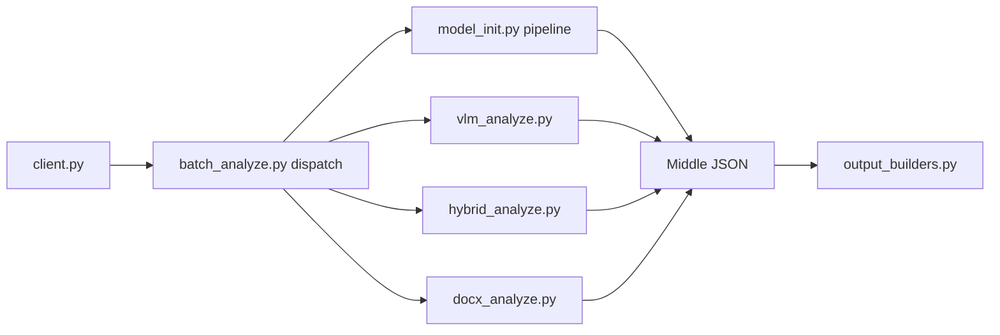

# opendatalab/MinerU

> Local document parser (PDF, images, Office) to Markdown/JSON, usable via CLI, SDK, API, or agent.

## The problem
Extracting clean text, tables, and formulas from a scanned PDF or an Office file for use with a large language model (LLM) or Retrieval-Augmented Generation (RAG) often results in disorganized text.

## What it actually does
The CLI (`client.py`) directs each document according to its format and the chosen backend: a local pipeline (layout, OCR, formulas, tables; `model_init.py`), VLM (`vlm_analyze.py`), a hybrid of native text + model (`hybrid_analyze.py`), or native Office analyzers (`docx_analyze.py`).
All paths converge to a common "middle JSON," which `output_builders.py` converts to Markdown, HTML, LaTeX, DOCX, etc. There are four levels: Flash, Basic, Standard, and Advanced.
Version 4.0 adds a local document library (cache, search, page-by-page reading with stable locators for citations), a Python SDK, an API, and a Gradio WebUI.

## How it is wired


## Trying it
```bash
pip install uv
uv venv .mineru --python 3.12
source .mineru/bin/activate
uv pip install -U "mineru>=4.0,<5"
mineru-kit parse document.pdf -o document.md --tier standard
mineru-kit webui
```

## Cost and gotchas
Free; runs on CPU (ONNX, llama.cpp Vulkan). `mineru[full]` for NVIDIA GPUs. Docker for non-NVIDIA hardware is under development.

## What it is not
The README states: it is neither a RAG framework, nor a vector database, nor a chat application with document access. The `mineru parse --json` command defaults to parsing only the first 10 pages. Nothing is sent to the official service without explicit configuration.

## Alternatives
No alternative is specified in the README file.

## For you
These should be adopted as the foundation for your RAG (Retrieval-Augmented Generation) and document extraction pipelines.
