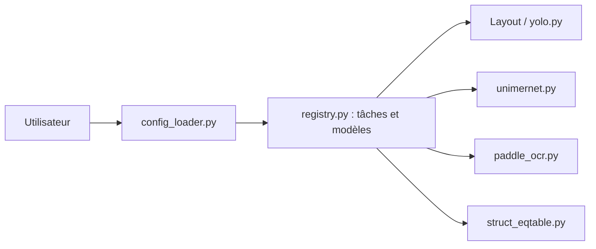

# opendatalab/PDF-Extract-Kit

> Model toolbox for extracting content, formulas, tables and text from complex PDFs.

## The problem
Scientific or financial PDFs mix columns, formulas and tables, which are hard for a simple text extractor to read.

## What it actually does
Assembles models: layout detection (DocLayout-YOLO, YOLO-v10, LayoutLMv3), formula detection (YOLOv8), formula recognition (UniMERNet), OCR (PaddleOCR) and tables (StructEqTable, TableMaster). Each task is launched via a script and a configuration file. A sample application converts a PDF to Markdown; the README points to MinerU for that use.

## How it is wired


## Trying it
```bash
conda create -n pdf-extract-kit-1.0 python=3.10
conda activate pdf-extract-kit-1.0
pip install -r requirements.txt
python scripts/layout_detection.py --config=configs/layout_detection.yaml
python scripts/ocr.py --config=configs/ocr.yaml
```

## Cost and gotchas
Free. You must download the model weights (Hugging Face or ModelScope); a GPU is recommended (otherwise a `requirements-cpu.txt` variant). AGPL-3.0 license.

## What it is not
Not a turnkey PDF-to-Markdown converter (that is MinerU); the evaluation section is "Coming Soon". Last push in January 2025.

## Alternatives
- MinerU: complete conversion tool built on this kit.
- UniMERNet: formula recognition algorithm.

## For you
Watch: interesting for technical PDFs in a RAG pipeline, but heavy (GPU, weights) and not very active; MinerU is more direct.
