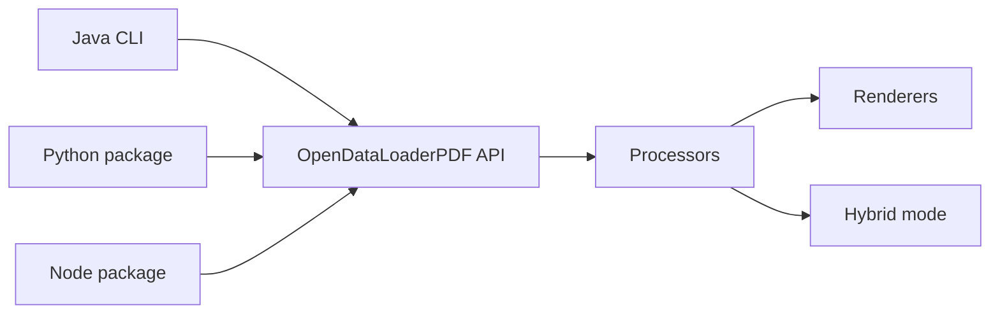

# opendataloader-project/opendataloader-pdf

> Java PDF parser (Python, Node, Java SDKs) that outputs Markdown and JSON for RAG, with accessibility auto-tagging.

## The problem
PDF parsers lose reading order, break tables and do not give element coordinates.

## What it actually does
Deterministic local mode (CPU, no GPU): text with XY-Cut++ reading order, tables, headings, lists, bounding boxes, JSON, Markdown, HTML or annotated PDF output. Hybrid mode: a local server (Docling) handles complex pages, OCR, LaTeX formulas and image descriptions. Filters hidden text (prompt injection); optional `--sanitize`. `format="tagged-pdf"` produces a tagged PDF; PDF/UA export is an enterprise option.

## How it is wired


## Trying it
```bash
pip install -U opendataloader-pdf
pip install -U "opendataloader-pdf[hybrid]"
opendataloader-pdf-hybrid --port 5002
opendataloader-pdf --hybrid docling-fast file1.pdf file2.pdf folder/
```

## Cost and gotchas
Free for the core; PDF/UA and the accessibility studio are paid. Java 11+ required; each call launches a JVM, so process in batches. OCR and image description on CPU can take over a minute per image.

## What it is not
Does not handle Word, Excel or PowerPoint. The "#1" rankings come from the author's benchmarks. No PDF/UA compliance in the free version.

## Alternatives
docling, marker, pymupdf4llm (compared in the README).

## For you
Adopt it to feed a RAG pipeline: structured output with coordinates for citations, local with no cloud, Apache-2.0 license.
