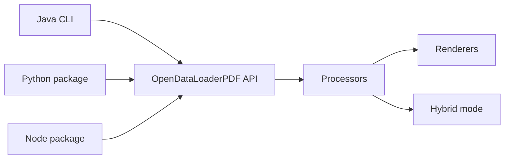

# opendataloader-project/opendataloader-pdf

> Parseur PDF en Java (SDK Python, Node, Java) qui sort Markdown et JSON pour RAG, avec auto-tagging d'accessibilité.

## Le problème
Les parseurs PDF perdent l'ordre de lecture, cassent les tableaux et ne donnent pas les coordonnées des éléments.

## Ce que ça fait vraiment
Mode local déterministe (CPU, sans GPU) : texte avec ordre de lecture XY-Cut++, tableaux, titres, listes, boîtes englobantes, sortie JSON, Markdown, HTML ou PDF annoté. Mode hybride : un serveur local (Docling) traite pages complexes, OCR, formules LaTeX et descriptions d'images. Filtre les textes cachés (injection de prompt) ; `--sanitize` optionnel. `format="tagged-pdf"` produit un PDF balisé ; l'export PDF/UA est une option entreprise.

## Comment c'est branché


## Essayer
```bash
pip install -U opendataloader-pdf
pip install -U "opendataloader-pdf[hybrid]"
opendataloader-pdf-hybrid --port 5002
opendataloader-pdf --hybrid docling-fast file1.pdf file2.pdf folder/
```

## Coût et pièges
Gratuit pour le cœur ; PDF/UA et studio d'accessibilité sont payants. Java 11+ requis ; chaque appel lance une JVM, donc traiter par lots. L'OCR et la description d'images en CPU peuvent prendre plus d'une minute par image.

## Ce que ce n'est pas
Ne traite pas Word, Excel ni PowerPoint. Les classements « n°1 » viennent des benchmarks de l'auteur. Pas de conformité PDF/UA dans la version gratuite.

## Alternatives
docling, marker, pymupdf4llm (comparés dans le README).

## Pour toi
À adopter pour alimenter un pipeline RAG : sortie structurée avec coordonnées pour les citations, local sans cloud, licence Apache-2.0.

