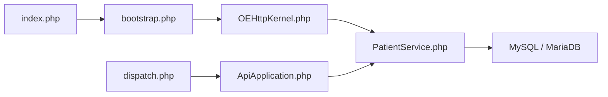

# openemr/openemr

> Open source electronic health record and practice management system, in PHP, for healthcare organizations.

## The problem
Practices need patient records, scheduling and billing without proprietary software.

## What it actually does
PHP/MySQL web application: clinical records, appointments, prescriptions, billing, patient portal. Exposes a REST API, FHIR R4 and SMART-on-FHIR, OAuth2. Docker-oriented deployment, extension modules, background tasks.

## How it is wired


## Trying it
```shell
composer install --no-dev
npm install
npm run build
composer dump-autoload -o
```

## Cost and gotchas
Free. Node 24 is required for the build. Health data: regulatory responsibility is yours.

## What it is not
Not a data science tool. The code mixes legacy PHP and newer services.

## Alternatives
No alternative cited in the README.

## For you
Ignore: medical domain outside your profile, unless you have a specific FHIR interoperability project.
