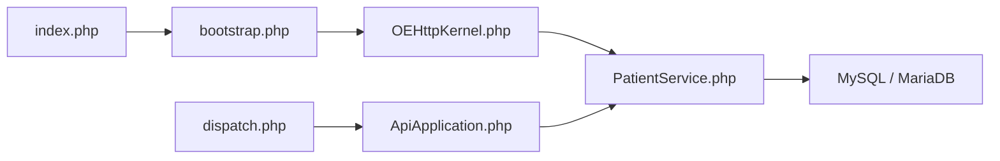

# openemr/openemr

> Dossier médical électronique et gestion de cabinet open source, en PHP, pour structures de santé.

## Le problème
Les cabinets ont besoin d'un dossier patient, d'agenda et de facturation sans logiciel propriétaire.

## Ce que ça fait vraiment
Application web PHP/MySQL : dossiers cliniques, rendez-vous, prescriptions, facturation, portail patient. Expose une API REST, FHIR R4 et SMART-on-FHIR, OAuth2. Déploiement orienté Docker, modules d'extension, tâches de fond.

## Comment c'est branché


## Essayer
```shell
composer install --no-dev
npm install
npm run build
composer dump-autoload -o
```

## Coût et pièges
Gratuit. Node 24 requis pour le build. Données de santé : responsabilité réglementaire à ta charge.

## Ce que ce n'est pas
Pas un outil de data science. Code mêlant PHP legacy et services récents.

## Alternatives
Aucune alternative citée dans le README.

## Pour toi
À ignorer : domaine médical hors profil, sauf projet d'interopérabilité FHIR précis.

