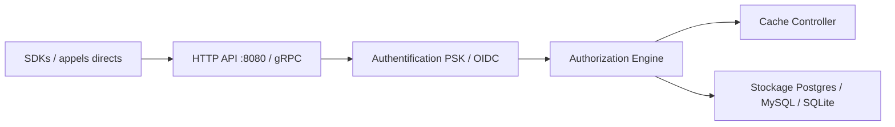

# openfga/openfga

> A fine-grained authorization engine inspired by Google Zanzibar, for developers who model access rights.

## The problem
Hand-coding permission rules (who can see or edit what) becomes unmanageable as soon as relationships multiply.

## What it actually does
A server exposing HTTP (8080) and gRPC APIs: you write an authorization model, record relationship tuples, then ask check questions. Storage in memory (development only), PostgreSQL 14+, MySQL 8, SQLite (beta). SDKs for Java, Node.js, Go, Python, .NET; CLI, Terraform provider, local playground.

## How it is wired


## Trying it
```bash
docker run -p 8080:8080 -p 3000:3000 openfga/openfga run
curl -X POST 'localhost:8080/stores' --header 'Content-Type: application/json' --data-raw '{"name": "openfga-demo"}'
```

## Cost and gotchas
Free. The default in-memory storage loses everything on shutdown. The playground is for local use only. Tuple length limits are stricter under MySQL.

## What it is not
Not an authentication service (identity, login): it decides permissions, it does not manage accounts.

## Alternatives
No alternative named in the README.

## For you
Worth watching: relevant if you are building a data platform or app with per-object permissions; overkill for simple role-based control.
