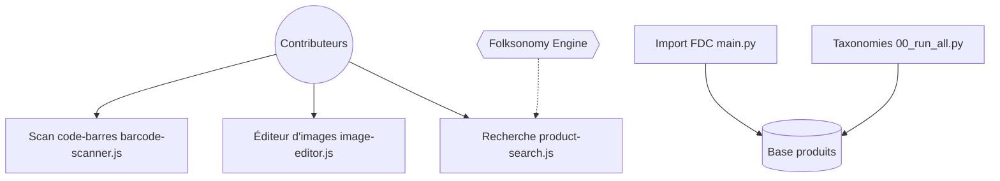

# openfoodfacts/openfoodfacts-server

> Product Opener server of Open Food Facts and Open Beauty Facts, an open database of food products.

## The problem
The information on labels (ingredients, allergens, nutrition) is scattered and closed without a collaborative database.

## What it actually does
Product Opener is the server of the collaborative Open Food Facts database, written in Perl, HTML and JavaScript. Contributors scan barcodes, edit images and import files. It works with Robotoff (the project's AI, in Python). Based on the code provided: FDC data import scripts, taxonomy generation, packager code refresh. The server part does not appear in the excerpt.

## How it is wired


## Trying it
```bash
make up
```
The README refers to the Docker quick-start guide for the rest.

## Cost and gotchas
Docker is required for development; `make up` also launches a front-end build container. Many open issues (1,867).

## What it is not
It is not the API or the mobile app: the README points elsewhere for the API documentation. AGPL license: obligations when running a network service.

## Alternatives
No alternative named in the README.

## For you
Worth watching: mainly as a source of open data (1.7 million products announced) and for Robotoff, more than for its Perl code.
