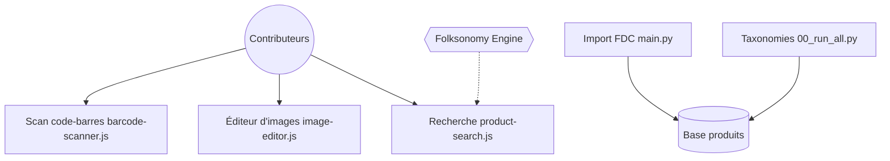

# openfoodfacts/openfoodfacts-server

> Serveur Product Opener d'Open Food Facts et Open Beauty Facts, base ouverte de produits alimentaires.

## Le problème
Les informations des étiquettes (ingrédients, allergènes, nutrition) sont dispersées et fermées sans base collaborative.

## Ce que ça fait vraiment
Product Opener est le serveur de la base collaborative Open Food Facts, écrit en Perl, HTML et JavaScript. Les contributeurs scannent des codes-barres, éditent des images et importent des fichiers. Il fonctionne avec Robotoff (l'IA du projet, en Python). D'après le code fourni : scripts d'import de données FDC, génération de taxonomies, rafraîchissement des codes d'emballeurs. La partie serveur n'apparaît pas dans l'extrait.

## Comment c'est branché


## Essayer
```bash
make up
```
Le README renvoie au guide de démarrage rapide Docker pour la suite.

## Coût et pièges
Docker requis pour développer ; `make up` lance aussi un conteneur de build du front. Beaucoup d'issues ouvertes (1 867).

## Ce que ce n'est pas
Ce n'est pas l'API ni l'appli mobile : le README renvoie la documentation de l'API ailleurs. Licence AGPL : obligations en cas de service réseau.

## Alternatives
Aucune alternative nommée dans le README.

## Pour toi
À surveiller : surtout comme source de données ouvertes (1,7 million de produits annoncés) et pour Robotoff, plus que pour son code Perl.

