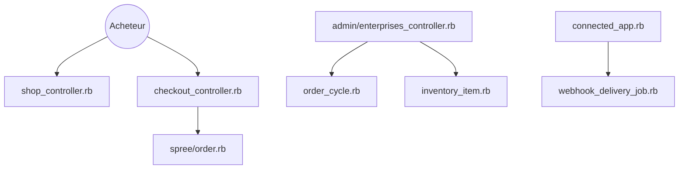

# openfoodfoundation/openfoodnetwork

> Online marketplace for local food, connecting producers, hubs and buyers.

## The problem
Small producers struggle to sell directly without a platform that handles shops, order cycles and payments.

## What it actually does
Based on the code (Ruby, Rails): per-business shops, catalog, cart, payment (Stripe), order cycles, inventory, reports, public API, webhooks and connected apps. The README, for its part, mostly talks about the community and guides. Deployment goes through a separate Ansible repository.

## How it is wired


## Trying it
```bash
# Aucune commande dans le README : provisionnement via le dépôt ofn-install (Ansible).
```

## Cost and gotchas
Free, but hosting a server remains at your expense. 649 open issues. AGPL license.

## What it is not
Not a reusable building block: it is a complete application. Not a data tool.

## Alternatives
The README mentions ofn-install for installation, no alternative.

## For you
Ignore: a business e-commerce application unrelated to a data, AI or MLOps path, under the AGPL license.
