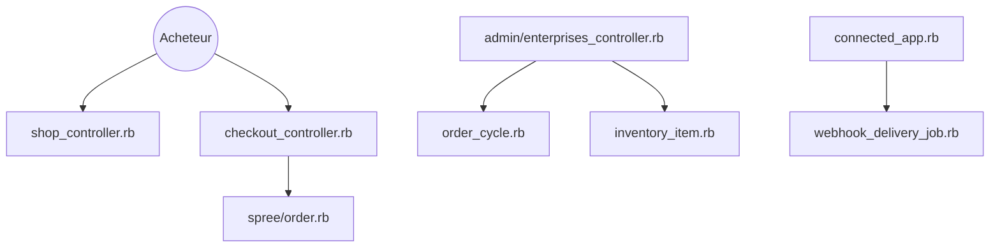

# openfoodfoundation/openfoodnetwork

> Place de marché en ligne pour l'alimentation locale, reliant producteurs, hubs et acheteurs.

## Le problème
Les petits producteurs ont du mal à vendre en direct sans plateforme qui gère boutiques, cycles de commande et paiements.

## Ce que ça fait vraiment
D'après le code (Ruby, Rails) : boutiques par entreprise, catalogue, panier, paiement (Stripe), cycles de commande, inventaire, rapports, API publique, webhooks et applications connectées. Le README, lui, parle surtout de la communauté et des guides. Le déploiement passe par un dépôt Ansible séparé.

## Comment c'est branché


## Essayer
```bash
# Aucune commande dans le README : provisionnement via le dépôt ofn-install (Ansible).
```

## Coût et pièges
Gratuit, mais l'hébergement d'un serveur reste à ta charge. 649 issues ouvertes. Licence AGPL.

## Ce que ce n'est pas
Pas une brique réutilisable : c'est une application complète. Pas un outil data.

## Alternatives
Le README mentionne ofn-install pour l'installation, pas d'alternative.

## Pour toi
À ignorer : application métier de e-commerce sans rapport avec un parcours data, IA ou MLOps, sous licence AGPL.

