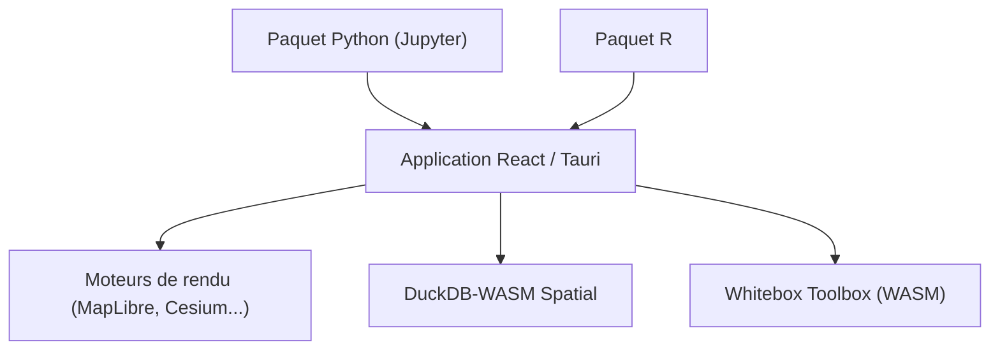

# opengeos/GeoLibre

> Open-source GIS running in the browser, on desktop, mobile and Jupyter, with more than 1000 geoprocessing tools.

## The problem
Classic GIS software requires a heavy installation or sends data to a server.

## What it actually does
Tauri v2 application, React, TypeScript, MapLibre GL JS, DuckDB-WASM Spatial and deck.gl. Visualization of geospatial data with four rendering engines (MapLibre, Mapbox, Cesium, ArcGIS). The Whitebox toolbox runs more than 1000 tools (terrain, hydrology, LiDAR, remote sensing) in WebAssembly in the browser, without a server. Python and R packages, Chrome extension.

## How it is wired

Diagram inferred from the README; no diagram provided.

## Trying it
No command actually present in the README provided: it points to GeoLibre Web (browser), the installers and the getting-started guide on geolibre.app.

## Cost and gotchas
Cost: free. Mapbox, Cesium and ArcGIS require their own credentials.

## What it is not
Not a map server: everything runs client-side. The Mapbox and ArcGIS renderers depend on third-party accounts.

## Alternatives
No alternative named in the README.

## For you
Worth watching: useful for local geospatial analysis (GeoParquet, COG) without infrastructure, if your work touches spatial data.
