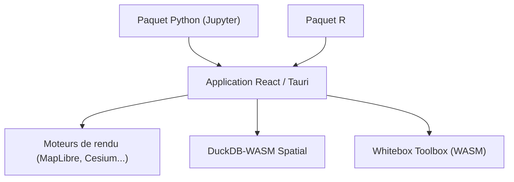

# opengeos/GeoLibre

> SIG open source tournant dans le navigateur, sur bureau, mobile et Jupyter, avec plus de 1000 outils de géotraitement.

## Le problème
Les SIG classiques demandent une installation lourde ou envoient les données vers un serveur.

## Ce que ça fait vraiment
Application Tauri v2, React, TypeScript, MapLibre GL JS, DuckDB-WASM Spatial et deck.gl. Visualisation de données géospatiales avec quatre moteurs de rendu (MapLibre, Mapbox, Cesium, ArcGIS). La boîte à outils Whitebox exécute plus de 1000 outils (terrain, hydrologie, LiDAR, télédétection) en WebAssembly dans le navigateur, sans serveur. Paquets Python et R, extension Chrome.

## Comment c'est branché

Schéma déduit du README ; aucun diagramme fourni.

## Essayer
Aucune commande réellement présente dans le README fourni : il renvoie à GeoLibre Web (navigateur), aux installateurs et au guide de démarrage sur geolibre.app.

## Coût et pièges
Coût : gratuit. Mapbox, Cesium et ArcGIS demandent leurs propres identifiants.

## Ce que ce n'est pas
Pas un serveur de cartes : tout s'exécute côté client. Les rendus Mapbox et ArcGIS dépendent de comptes tiers.

## Alternatives
Aucune alternative nommée dans le README.

## Pour toi
Surveiller : utile pour de l'analyse géospatiale locale (GeoParquet, COG) sans infrastructure, si ton travail touche aux données spatiales.

