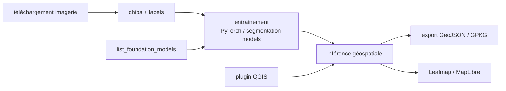

# opengeos/geoai

> Python package that bridges deep learning and geospatial data, for researchers and GIS practitioners.

## The problem
Applying deep learning to satellite imagery means stitching together separate ecosystems:
general-purpose ML libraries on one side, geospatial tools on the other.
Preprocessing (chips, labels, reprojection) is redone for every project.

## What it actually does
Six capabilities: imagery search and download (Sentinel, Landsat, NAIP, Overture Maps),
automated preparation of training sets (chips + labels), classification / detection / segmentation training,
inference pipelines, visualization via Leafmap and MapLibre, and a QGIS plugin.
Catalog of 20 remote-sensing foundation models: `list_foundation_models()`,
`get_foundation_model_info()`, `load_foundation_model()` (TerraTorch backbones).
Formats GeoTIFF, JPEG2000, GeoJSON, Shapefile, GeoPackage, GeoParquet; automatic device handling.

## How it is wired


## Trying it
```bash
pip install geoai-py
conda install -c conda-forge geoai
mamba install -c conda-forge geoai
```

## Cost and gotchas
Free. GPU acceleration if available, otherwise CPU. Imagery sources may require accounts
with the provider; the README does not detail this. Research partly funded by NASA and USGS.

## What it is not
It is not a low-level engine: it is a high-level layer on top of PyTorch, Transformers,
segmentation models and torchange. It is not a full GIS nor a replacement for QGIS.
The foundation model catalog is taken from an external list, not trained here.

## Alternatives
TorchGeo, TerraTorch and SRAI, cited as excellent low-level foundations, less "high-level" than geoai.

## For you
The credible shortcut if you need to produce building footprints or a land-cover classification.
