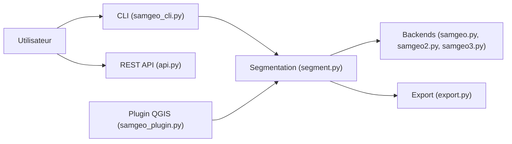

# opengeos/segment-geospatial

> Python package that applies Segment Anything to geospatial imagery, with a CLI, a REST API and a QGIS plugin.

## The problem
Applying SAM to GeoTIFFs requires handling tiles, georeferencing and vector export around the model.

## What it actually does
It downloads TMS tiles to GeoTIFF, segments with SAM, SAM 2, SAM 3, FastSAM or HQ-SAM, accepts point, box or text prompts (Grounding DINO), processes time series, saves to GeoPackage, Shapefile or GeoJSON, and displays on interactive maps. It also offers a Click CLI, a FastAPI REST API and a QGIS plugin that installs its own dependencies.

## How it is wired


## Trying it
```bash
pip install "segment-geospatial[samgeo3]"
conda install -c conda-forge segment-geospatial
pixi init geo && cd geo && pixi install
```

## Cost and gotchas
Free; a GPU of at least 8 GB is recommended, Colab is possible. Installing SAM 3 on Windows is tricky. You must get the basemap provider's agreement before a massive tile download.

## What it is not
Not a model trained by the project: it wraps SAM and its variants. The README states educational use, at your own risk.

## Alternatives
Not documented in the README (it cites segment-anything-eo as its origin, and ArcGIS's SAM toolbox).

## For you
Relevant if you do vision on satellite or aerial imagery: ready-to-use text-prompted segmentation; plan for a GPU.
