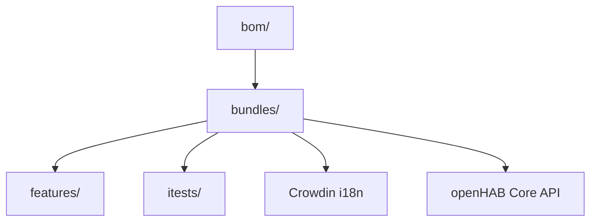

# openhab/openhab-addons

> Official set of openHAB Java extensions (bindings) to integrate home automation devices.

## The problem
Connecting hundreds of brands of connected devices to a single home automation platform.

## What it actually does
Maven repository of `.jar` bundles (one per binding: airquality, astro...) built on the openHAB Core API. Contains the Karaf features, integration tests, Checkstyle/Spotless checks and translations managed via Crowdin. The README is a developer guide, not a functional presentation.

## How it is wired


## Trying it
```bash
mvn clean install
mvn clean install -pl :org.openhab.binding.astro
mvn spotless:check
```

## Cost and gotchas
Free; the Maven build is slow on the whole repository (skip options offered).

## What it is not
Not the openHAB platform itself: only its extensions.

## Alternatives
No alternative named.

## For you
Ignore: Java home automation unrelated to data/AI/MLOps.
