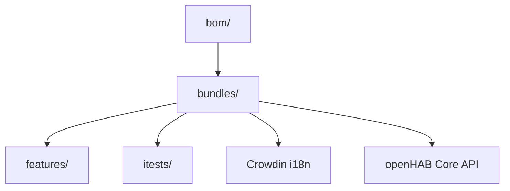

# openhab/openhab-addons

> Ensemble officiel d'extensions Java (bindings) d'openHAB pour intégrer des appareils domotiques.

## Le problème
Connecter des centaines de marques d'objets connectés à une plateforme domotique unique.

## Ce que ça fait vraiment
Dépôt Maven de bundles `.jar` (un par binding : airquality, astro…) bâtis sur l'API Core d'openHAB. Contient les features Karaf, les tests d'intégration, les contrôles Checkstyle/Spotless et les traductions gérées via Crowdin. Le README est un guide développeur, pas une présentation fonctionnelle.

## Comment c'est branché


## Essayer
```bash
mvn clean install
mvn clean install -pl :org.openhab.binding.astro
mvn spotless:check
```

## Coût et pièges
Gratuit ; build Maven lent sur tout le dépôt (options de saut proposées).

## Ce que ce n'est pas
Pas la plateforme openHAB elle-même : uniquement ses extensions.

## Alternatives
Aucune alternative nommée.

## Pour toi
Ignorer : domotique Java sans lien avec data/IA/MLOps.

