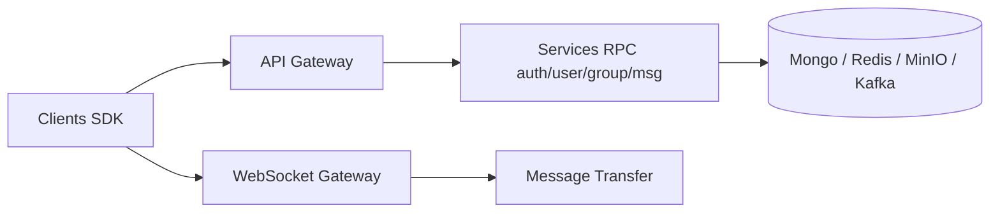

# openimsdk/open-im-server

> Open-source instant messaging server, to be integrated into your own applications, for developers.

## The problem
Adding chat to an application forces you to build sending, groups and users, or to depend on a third-party service.

## What it actually does
A Go microservices server (gateway, RPC services) with a client SDK. It handles messages, users, friends, groups, conversations; REST API for business logic and webhooks before/after events. Claims groups of hundreds of thousands of users (README claim). According to the code: MongoDB, Redis, MinIO, Kafka and etcd in the background.

## How it is wired

## Trying it
The README points to deployment guides (source, Docker): no command is present.

## Cost and gotchas
Heavy stack (Mongo, Redis, Kafka, MinIO) to host. Installation documentation is external.

## What it is not
It is not an installable chat application: the README says so explicitly, it is a foundation for developers, compared to Telegram, Signal, Rocket.Chat.

## Alternatives
Telegram, Signal and Rocket.Chat are cited as standalone applications, not as equivalents.

## For you
Worth watching: relevant only if you need to embed chat in a product; of little use for data/MLOps work.
