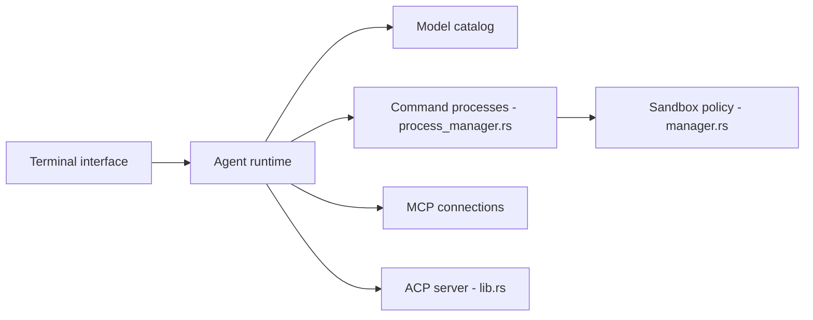

# openinterpreter/openinterpreter

> A code agent running in a terminal, rewritten in Rust on Codex, which emulates multiple agent frameworks.

## The problem
Budget-friendly models don't perform as well as high-end models; the harness that surrounds them plays a significant role in their performance.

## What it actually does
Fork of OpenAI Codex in Rust. `/harness` switches between emulated environments (claude-code, kimi-code, qwen-code, deepseek-tui, swe-agent, minimal…), `/model` changes provider. Executes commands in a native sandbox, supports ACP for editors and the Codex `exec` protocol (compatible SDK), reads `AGENTS.md` and `.agents/skills`, supports MCP, hooks, and permissions. A QA skill can pilot web or native interfaces.

## How it is wired


## Trying it
```bash
curl -fsSL https://www.openinterpreter.com/install | sh
interpreter
interpreter acp
```

## Cost and gotchas
Free, but requires a model provider with their key and invoice. Installation via a script piped into the shell: please read before executing.

## What it is not
Not the original Python project: this one survives in a community fork (endolith/open-interpreter). The graphs indicate that the runtime wiring has not been sampled.

## Alternatives
- endolith/open-interpreter: Original Python version, maintained by the community.

## For you
Things to watch out for: Interesting for testing relatively inexpensive models with a proven, but young and highly dependent on suppliers, system.
