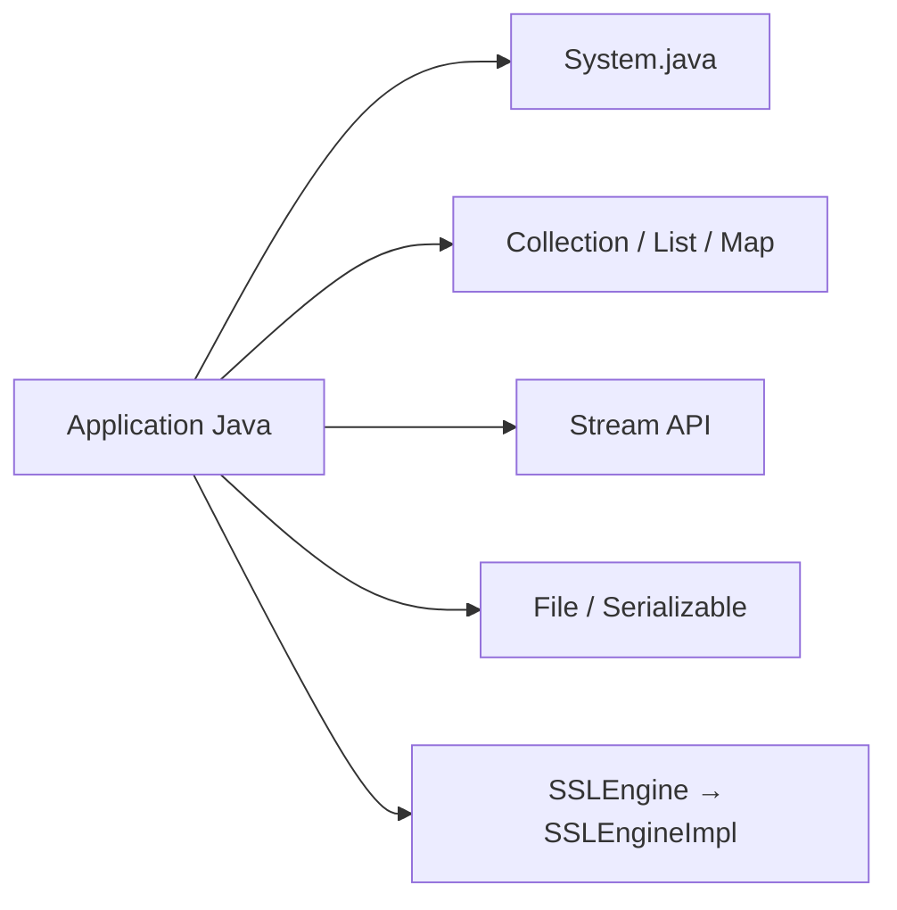

# openjdk/jdk

> Source code of the OpenJDK JDK, for Java platform developers and contributors.

## The problem
Minimal README: it says nothing about the problem solved beyond presenting the JDK.

## What it actually does
The README points to the online documentation (`doc/building.md`) for building, to the OpenJDK community and to issue tracking. The sampled architecture shows standard APIs (collections, streams, I/O, serialization) and a TLS engine (`SSLEngine`).

## How it is wired

## Trying it
No command documented in the README; see `doc/building.md`.

## Cost and gotchas
Not documented here. GPL-2.0 license (catalog facts).

## What it is not
Not an installable distribution: you need a build or a binary from a vendor.

## Alternatives
No alternative named in the README.

## For you
Nothing to adopt: the Java runtime is installed through a package; ignore for your watch, unless you contribute to the JVM.
