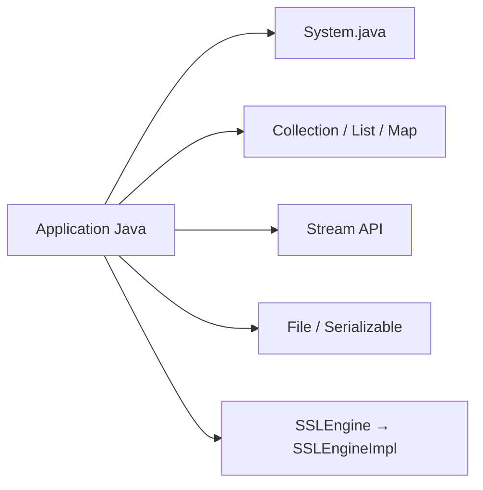

# openjdk/jdk

> Code source du JDK OpenJDK, pour développeurs de la plateforme Java et contributeurs.

## Le problème
README minimal : il ne dit rien du problème résolu au-delà de présenter le JDK.

## Ce que ça fait vraiment
Le README renvoie vers la documentation en ligne (`doc/building.md`) pour compiler, vers la communauté OpenJDK et le suivi des tickets. L'architecture échantillonnée montre des API standard (collections, flux, E/S, sérialisation) et un moteur TLS (`SSLEngine`).

## Comment c'est branché

## Essayer
Aucune commande documentée dans le README ; voir `doc/building.md`.

## Coût et pièges
Non documenté ici. Licence GPL-2.0 (faits du catalogue).

## Ce que ce n'est pas
Pas une distribution installable : il faut une build ou un binaire d'un fournisseur.

## Alternatives
Aucune alternative nommée dans le README.

## Pour toi
Rien à adopter : le runtime Java s'installe par un paquet ; à ignorer pour ta veille, sauf si tu contribues à la JVM.

