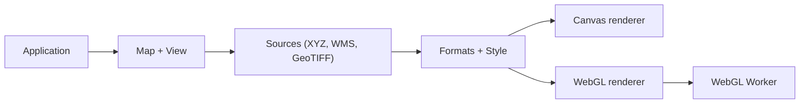

# openlayers/openlayers

> JavaScript library for displaying interactive maps in a web page, for front-end developers.

## The problem
Displaying tiles, vector data and markers from varied sources on a web map, with projections and interactions, takes a lot of custom code.

## What it actually does
A map (`Map`) and a view (`View`) combine layers and sources (XYZ, OSM, WMTS, WMS, vector tiles, GeoTIFF). Data goes through format modules, is styled, then rendered by Canvas or WebGL. A WebGL worker exists in `src/ol/worker/webgl.js`. The package is modular.

## How it is wired


## Trying it
```bash
npm install ol
```

## Cost and gotchas
Free. Base maps (e.g. OpenStreetMap tiles in the example) depend on third-party services with their own terms.

## What it is not
Not a mapping service or a server-side GIS: it is a browser-side library, with no data provided. 851 open issues.

## Alternatives
No alternative named in the README.

## For you
Watch: useful if a geospatial dashboard requires it, but outside the data/AI/MLOps core.
