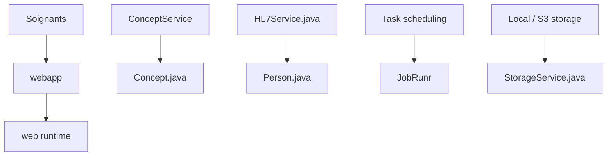

# openmrs/openmrs-core

> Open source electronic medical record platform for resource-limited health systems.

## The problem
Low-budget health facilities have no free, customizable patient record system.

## What it actually does
Java (Maven) application that manages patients, clinical concepts, visits, observations, orders, allergies and care programs. Extensible modules, HL7 messaging, scheduler (JobRunr), local or S3 storage, Lucene or Elasticsearch index, optional Grafana. Produces an openmrs.war to deploy.

## How it is wired


## Trying it
```bash
git clone https://github.com/openmrs/openmrs-core.git
cd openmrs-core
./mvnw clean package
docker compose build
docker compose up
```

## Cost and gotchas
Java 8 minimum and Maven. Demo passwords are visible in the README (admin / Admin123): change them. Docker deployment is noted as work in progress. A license is present but not identified.

## What it is not
Not a turnkey solution: you need modules, configuration and health compliance.

## Alternatives
No alternative named in the README.

## For you
Ignore: a Java patient record system, useful only if you work on OpenMRS health data.
