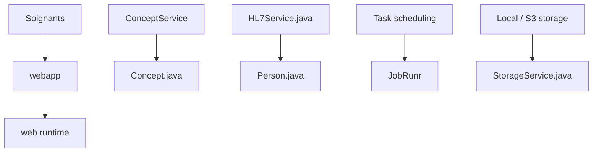

# openmrs/openmrs-core

> Plateforme de dossier médical électronique open source pour systèmes de santé aux ressources limitées.

## Le problème
Les établissements de santé à budget réduit n'ont pas de dossier patient personnalisable et gratuit.

## Ce que ça fait vraiment
Application Java (Maven) qui gère patients, concepts cliniques, visites, observations, ordres, allergies et programmes de soins. Modules extensibles, messagerie HL7, planificateur (JobRunr), stockage local ou S3, index Lucene ou Elasticsearch, Grafana en option. Produit un openmrs.war à déployer.

## Comment c'est branché


## Essayer
```bash
git clone https://github.com/openmrs/openmrs-core.git
cd openmrs-core
./mvnw clean package
docker compose build
docker compose up
```

## Coût et pièges
Java 8 minimum et Maven. Mots de passe de démonstration visibles dans le README (admin / Admin123) : à changer. Le déploiement Docker est noté en chantier. Licence présente mais non identifiée.

## Ce que ce n'est pas
Pas une solution clés en main : il faut modules, configuration et conformité santé.

## Alternatives
Aucune alternative nommée dans le README.

## Pour toi
Ignorer : un DPI Java, utile seulement si tu travailles sur des données de santé OpenMRS.

