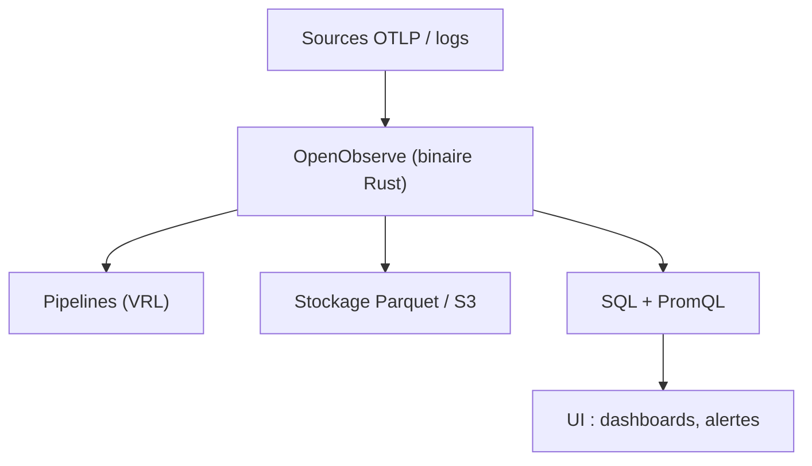

# openobserve/openobserve

> Open-source observability platform (logs, metrics, traces, RUM), a Datadog alternative.

## The problem
Datadog, Splunk and Elasticsearch are expensive in licensing and storage, and Grafana stacks require several components.

## What it actually does
A single Rust binary stores data as Parquet on S3 or disk. Logs and traces are queried in SQL, metrics in SQL or PromQL, natively OpenTelemetry. Dashboards, alerts, incidents, VRL pipelines at ingestion, RUM, and LLM observability (cost, tokens, latency). High-availability cluster mode.

## How it is wired


## Trying it
```bash
docker run -d \
  --name openobserve \
  -v $PWD/data:/data \
  -p 5080:5080 \
  -e ZO_ROOT_USER_EMAIL="root@example.com" \
  -e ZO_ROOT_USER_PASSWORD="Complexpass#123" \
  public.ecr.aws/zinclabs/openobserve:latest
```

## Cost and gotchas
Free when self-hosted; free cloud tier up to 50 GB/day (sign-up at that threshold). SSO, advanced RBAC, audit and federated search are reserved for the Enterprise edition. Change the example password.

## What it is not
Data is immutable: no modification or deletion, only expiration of periods. The figures (140x less storage) are the project's own, not verified here.

## Alternatives
Grafana / Loki / Prometheus / Tempo: several components instead of one.
Elasticsearch and Splunk: cited for comparison, heavier and more expensive according to the README.

## For you
Worth adopting for a trial: a single container is enough to centralize logs, traces and LLM monitoring for an MLOps platform; check the AGPL and the features reserved for the paid edition.
