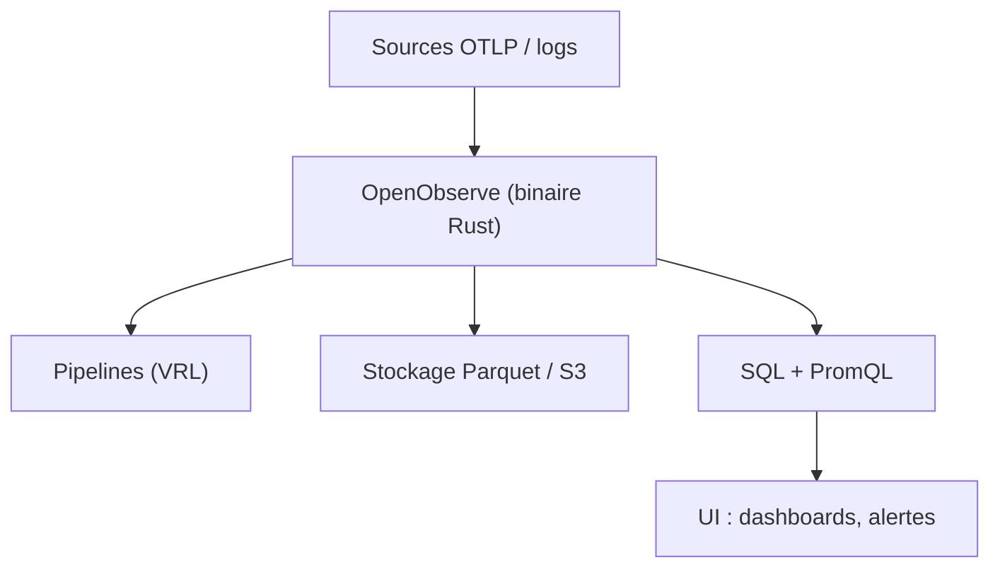

# openobserve/openobserve

> Plateforme d'observabilité open source (logs, métriques, traces, RUM) alternative à Datadog.

## Le problème
Datadog, Splunk et Elasticsearch coûtent cher en licence et en stockage, et les piles Grafana demandent plusieurs composants.

## Ce que ça fait vraiment
Un binaire Rust unique stocke les données en Parquet sur S3 ou disque. Logs et traces s'interrogent en SQL, métriques en SQL ou PromQL, natif OpenTelemetry. Tableaux de bord, alertes, incidents, pipelines VRL à l'ingestion, RUM, et observabilité LLM (coût, tokens, latence). Mode haute disponibilité en cluster.

## Comment c'est branché


## Essayer
```bash
docker run -d \
  --name openobserve \
  -v $PWD/data:/data \
  -p 5080:5080 \
  -e ZO_ROOT_USER_EMAIL="root@example.com" \
  -e ZO_ROOT_USER_PASSWORD="Complexpass#123" \
  public.ecr.aws/zinclabs/openobserve:latest
```

## Coût et pièges
Gratuit auto-hébergé ; offre cloud gratuite jusqu'à 50 Go/jour (inscription à ce seuil). SSO, RBAC avancé, audit et recherche fédérée sont réservés à l'édition Entreprise. Changer le mot de passe de l'exemple.

## Ce que ce n'est pas
Les données sont immuables : aucune modification ni suppression, seulement l'expiration de périodes. Les chiffres (140x de stockage en moins) sont ceux du projet, non vérifiés ici.

## Alternatives
Grafana / Loki / Prometheus / Tempo : plusieurs composants au lieu d'un.
Elasticsearch et Splunk : cités en comparaison, plus lourds et plus chers selon le README.

## Pour toi
À adopter pour un essai : un conteneur suffit pour centraliser logs, traces et suivi LLM d'une plateforme MLOps ; vérifier l'AGPL et les fonctions réservées à l'édition payante.

