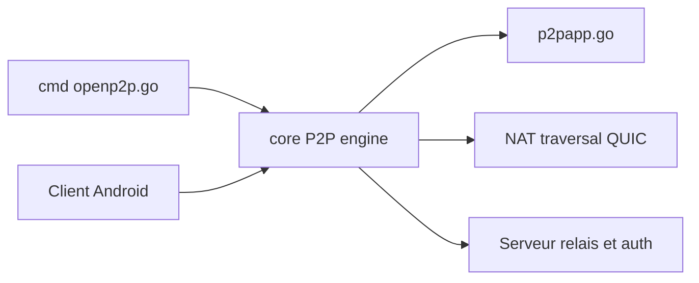

# openp2p-cn/openp2p

> P2P bandwidth-sharing network to access your machines remotely without a public IP.

## The problem
Reaching a PC, a NAS or a server on a private network without a public-IP server or a subscription.

## What it actually does
A lightweight Go client (10 MB) creates P2P tunnels (NAT hole punching, UDP/TCP, QUIC, UPnP, IPv6) between your devices, falling back on shared relays. The central concept is the P2PApp: a remote service (RDP, SSH) mapped to a local port. TLS 1.3 channel with additional AES encryption; relays authenticate with TOTP. An Android client exists. Using the public relays requires sharing your own nodes (10 Mbps by default).

## How it is wired


## Trying it
```bash
make
CGO_ENABLED=0 env GOOS=linux GOARCH=amd64 go build -o openp2p --ldflags '-s -w ' -gcflags '-l' -p 8 -installsuffix cgo ./cmd
```

## Cost and gotchas
Free, but requires an e-mail account on the orchestration service and contributing bandwidth. Windows may block the unsigned executable. Go 1.20 required.

## What it is not
Not an audited enterprise VPN. The README warns that a relay is a man in the middle, hence the AES encryption.

## Alternatives
No alternative named in the README.

## For you
Ignore: consumer remote access, with a dependency on a third-party relay service; for a GPU cluster, prefer controlled access.
