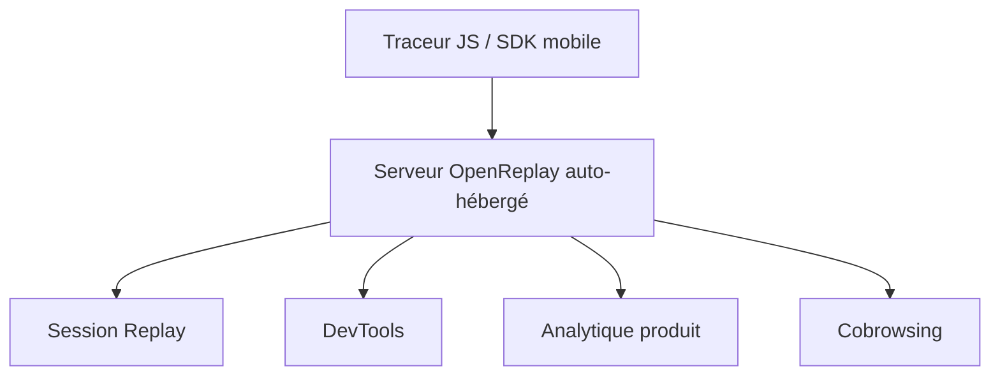

# openreplay/openreplay

> Self-hosted session replay and product analytics platform, for data-conscious web teams.

## The problem
Session replay tools are SaaS products that send user data to a third party, which blocks regulated sectors.

## What it actually does
Replays user sessions with developer tools (network, console, errors, state), analytics (funnels, heatmaps), WebRTC cobrowsing, the Spot Chrome extension and mobile replay (iOS, Android, React Native, in beta). Data masking at capture, private mode, roles and SSO. A JavaScript tracker integrates with React, Vue, Angular, etc.

## How it is wired

Diagram inferred from the README, no diagram from the code provided.

## Trying it
No command in the README: it points to the "Getting Started" guide (a VM with 2 vCPU, 8 GB of RAM, 50 GB of disk; Docker, Helm or bare metal).

## Cost and gotchas
Self-hosting is free; paid Cloud offerings (Serverless, Dedicated, BYOC). A VM with 2 vCPU / 8 GB / 50 GB minimum. Mobile replay in beta.

## What it is not
Not a complete back-end observability tool: it syncs with Sentry, Datadog, etc. SOC 2 compliance applies to the Cloud, not to self-hosting. The license is present but unidentified.

## Alternatives
FullStory, LogRocket and PostHog are compared in the README; PostHog is open source, and its Kubernetes self-hosting is described there as deprecated.

## For you
Worth watching: relevant if you need to analyze user behavior of an AI app without sending the data out, but the license needs checking.
