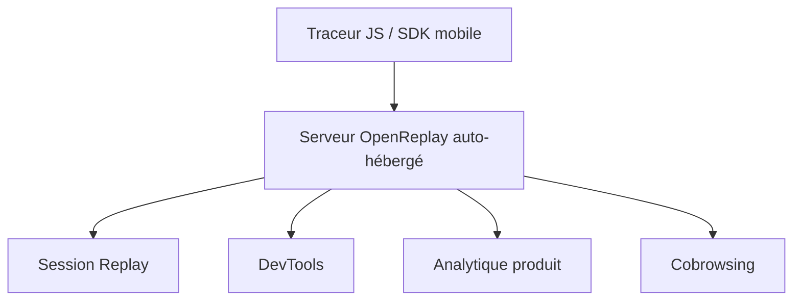

# openreplay/openreplay

> Plateforme auto-hébergée de replay de sessions et d'analytique produit, pour équipes web soucieuses des données.

## Le problème
Les outils de replay de sessions sont des SaaS qui envoient les données utilisateurs chez un tiers, ce qui bloque les secteurs réglementés.

## Ce que ça fait vraiment
Rejoue les sessions utilisateur avec outils de développement (réseau, console, erreurs, état), analytique (entonnoirs, heatmaps), cobrowsing WebRTC, extension Chrome Spot et replay mobile (iOS, Android, React Native, en bêta). Masquage des données à la capture, mode privé, rôles et SSO. Un traceur JavaScript s'intègre à React, Vue, Angular, etc.

## Comment c'est branché

Diagramme déduit du README, aucun diagramme du code fourni.

## Essayer
Aucune commande dans le README : il renvoie au guide « Getting Started » (une VM de 2 vCPU, 8 Go de RAM, 50 Go de disque ; Docker, Helm ou bare metal).

## Coût et pièges
Auto-hébergement gratuit ; offres Cloud payantes (Serverless, Dedicated, BYOC). Une VM de 2 vCPU / 8 Go / 50 Go minimum. Replay mobile en bêta.

## Ce que ce n'est pas
Pas un outil d'observabilité back-end complet : il se synchronise avec Sentry, Datadog, etc. La conformité SOC 2 concerne le Cloud, pas l'auto-hébergement. La licence est présente mais non identifiée.

## Alternatives
FullStory, LogRocket et PostHog sont comparés dans le README ; PostHog est open source, l'auto-hébergement Kubernetes y est décrit comme déprécié.

## Pour toi
À surveiller : pertinent si tu dois analyser le comportement utilisateur d'une appli IA sans sortir les données, mais la licence est à vérifier.

