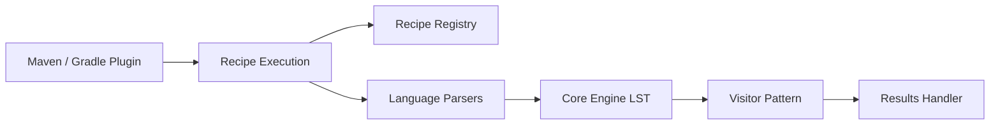

# openrewrite/rewrite

> Automated source-code refactoring engine, with recipes, maintained by Moderne.

## The problem
Migrating a framework, fixing a vulnerability or harmonizing style across a codebase takes days of manual edits.

## What it actually does
Runs recipes on a lossless semantic tree (LST), a typed model of the code built in memory on each run. Parsers for Java, Kotlin, Groovy, JavaScript/TypeScript, Python, C#, plus XML, YAML, Maven, Gradle. Maven and Gradle plugins run a recipe on a repository. The commercial Moderne platform runs on thousands of repositories.

## How it is wired

## Trying it
No command in the README: it points to the online getting-started guide.

## Cost and gotchas
Free for the framework; tiered licensing model. The parsers for non-Java languages are under the Moderne Source Available License (free on your own code) and proprietary recipes require a commercial license.

## What it is not
Not an AI: deterministic recipes. Multi-repository execution and tooling for agents belong to the paid product.

## Alternatives
No alternative named in the README.

## For you
Watch: useful for large-scale Java or Python code migrations; the multi-repository part is paid.
